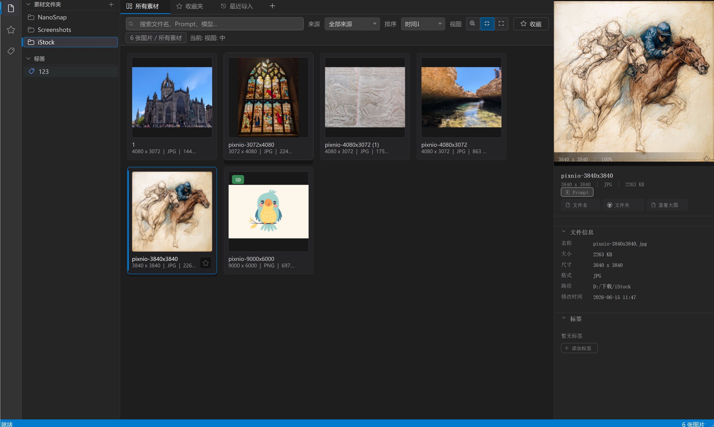
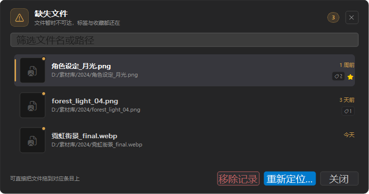

# PixoBook — AI 素材库 (AI Material Library)

A desktop application for managing, browsing, searching, and organizing AI-generated image assets. Built with **Qt 5** and **C++17**.



## Features

- **Smart import** — Scan directories for images; automatic duplicate detection via SHA-256 hashing
- **AI metadata parsing** — Automatically detects source tool and extracts generation parameters:
  - **Stable Diffusion** — Parses prompt, negative prompt, seed, steps, CFG scale, model, sampler from PNG `tEXt`/`zTXt`/`iTXt` chunks (including UTF-8 and zlib-compressed iTXt)
  - **Midjourney** — Extracts seed and model name from filename patterns
  - **DALL-E** — Extracts prompt from filename patterns
- **Database** — SQLite-backed storage with tags, favorites, and metadata querying
- **Full-text search** — FTS5 index over prompts and filenames. ASCII terms match word prefixes; CJK text is indexed per character so a substring such as "月光" matches inside a longer prompt. A **相关度** sort orders results by BM25 instead of time. Falls back to `LIKE` when the SQLite build has no FTS5.
- **Image gallery** — Grid-based thumbnail view with lazy loading, keyboard navigation, multi-select, and drag-and-drop import
- **Lightbox viewer** — Full-screen image viewer with zoom/pan and navigation
- **Detail panel** — Slide-out panel showing full image preview, metadata, and tag management
- **File watching** — Real-time monitoring of watched folders. New files are imported; a disappeared file is marked **missing** instead of being deleted, so tags and favorites survive an unplugged drive, a stale network share, or a temporarily unavailable folder. After every scan a background pass also catches files deleted while the app was closed. Rescanning the folder restores the row; the **查看缺失文件...** dialog can also relink one record to a moved file without losing its tags.
- **Annotation export / import** — Writes tags, favorites and parsed metadata as JSON (`pixobook-annotations.json`) and merges them back on another machine or database. Import matches by content hash first, then by path; tags are unioned, favorites only turned on, metadata fills rows that have none.
- **Custom dark theme** — Fully custom-painted UI with VS Code Codicon icon font
- **Command palette** — `Ctrl+Shift+P` quick action menu
- **Tag system** — Color-coded tags with filtering

## Build

### Prerequisites

- **Qt 5** (Widgets, Sql, Concurrent, Test)
- **CMake** 3.16+
- **C++17** compiler (MSVC recommended on Windows)

### Build steps

```bash
mkdir build
cd build
cmake ..
cmake --build .
```

### Run tests

```bash
cd build
ctest
```

### Benchmark

```bash
./build/RelWithDebInfo/pixobook_bench --assets 10000 --runs 30
```

The benchmark builds a synthetic library in a temporary database and reports
batched-import time plus search latency (min/p50/p95) for a common word, a
selective word, a miss, a CJK phrase, and a deep page. Compare the numbers
across commits; they are measurements of the same machine, not absolute
targets.

Reference run with the FTS5 index (development machine):

| assets | import | common | selective | miss | CJK | deep page |
|--------|--------|--------|-----------|------|-----|-----------|
| 10k    | 0.7 s  | 3.0 ms | 1.3 ms    | 0.1 ms | 1.0 ms | 4.2 ms |
| 50k    | 5.4 s  | 11.2 ms| 17.2 ms   | 0.2 ms | 8.9 ms | 9.8 ms |

The import figure includes building the search index. During a folder scan the
index is built once after the scan transaction commits, so import stays close
to the pre-FTS baseline (0.65 s / 5.2 s) instead of paying a per-file index
update. Relevance ordering (BM25) costs about 1.5 ms / 12.8 ms for a selective
term at 10k / 50k. Before FTS5, the same machine measured 31 ms / 308 ms for
the common word and 53 ms / 501 ms for the deep page at 10k / 50k.

## Recovery ledger



When a file moves or a drive is unplugged, the record is kept as *missing*
rather than deleted. The ledger groups those records, shows how long each has
been gone, and lets you point one at a new file by picking it or dropping it
onto the row. The record keeps its id, tags and favorite; the thumbnail slot
turns back into a real preview after relinking.

## Project structure

```
PixoBook/
├── CMakeLists.txt          # Build configuration
├── resources/              # Qt resources (fonts, QRC)
├── src/
│   ├── main.cpp            # Application entry point
│   ├── core/               # Interfaces and utilities
│   ├── database/           # SQLite database layer
│   ├── models/             # Data structures (Asset, Metadata, Tag)
│   ├── parsers/            # AI metadata parsers (SD/MJ/DALL-E)
│   ├── services/           # Business logic (scanner, cache, watcher, controller)
│   └── ui/                 # Qt widgets and custom-painted UI
├── tests/                  # Qt Test unit tests
└── docs/                   # Development documentation
```

## License

Proprietary — all rights reserved.
